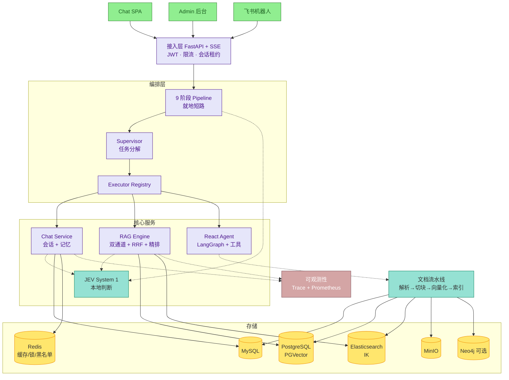

<div align="center">
  <h1>pipeline-rag</h1>
  <p>私有知识库问答与 AI Agent 平台 · 检索增强 + 多智能体协作 + 长期记忆 + 本地判断决策</p>

  <p>
    <a href="#项目简介">简介</a> •
    <a href="#核心能力">能力</a> •
    <a href="#系统架构">架构</a> •
    <a href="#技术栈">技术栈</a> •
    <a href="#快速开始">快速开始</a> •
    <a href="#docker-部署">部署</a>
  </p>

  <p>
    
    
    
    
    
    
    
  </p>
</div>

---

## 项目简介

面向知识库问答与复杂任务处理场景的 AI Agent 平台。系统基于 FastAPI 与 LangGraph 构建，围绕上下文精度、任务分解、记忆连续性三个问题，整合 PGVector + Elasticsearch 双通道召回、泛型 Pipeline 对话编排、Supervisor 任务分解、结构化摘要记忆等组件，并提供一套本地部署的 JEV 判断决策层替代大模型的判断类调用。

技术细节见 [`docs/`](docs/)。

## 核心能力

| 维度 | 能力 |
|------|------|
| **对话编排** | 9 阶段 Pipeline，规则层就地短路；意图分流规则快路径 + JEV 语义兜底 |
| **知识召回** | PGVector 向量 + Elasticsearch BM25 双通道 → RRF 融合 → Cross-Encoder 精排 → 证据闸门 |
| **多 Agent** | Supervisor 任务分解（LangGraph）+ 拓扑分层并发 + 结果汇总 |
| **长期记忆** | 结构化摘要（`summary_version` CAS 乐观锁）+ 滑动窗口；可选用户事实记忆（pgvector） |
| **文档接入** | 本地目录 / zip / 批量上传 + S3 / 网页连接器；解析 → 两阶段父子切块 → 向量化 → 索引 |
| **引用溯源** | 回答附来源引用（chunk_id / 章节 / 原文），前端可展开 |
| **本地判断（JEV）** | 护栏 / 意图 / 引用审计 / 证据充分性 / 质量审核 / 评测走本地单次前向，替代 LLM-as-Judge |
| **响应缓存** | 无历史上下文的确定性问答走 Redis 回放；SSE 断线续传 |
| **安全** | JWT + JTI 即时吊销、Lua 滑动窗口限流、Luhn 校验 PII、AST + `setrlimit` 沙箱、工具风险分级 |
| **可观测性** | 自研 Trace（span 树落库）+ Prometheus；可选 Langfuse / OpenTelemetry |

## 系统架构



- **接入层**：验签、限流、会话租约；SSE 长连接推流。
- **编排层**：9 阶段流水线逐级推演，护栏 / 闲聊 / 路由可尽早短路；产出 `ExecutionPlan` 后可选 Supervisor 分解。
- **核心服务**：会话与记忆、RAG 检索、ReAct Agent。
- **存储**：MySQL（元数据/父块/消息）、PGVector（子块向量）、ES（BM25）、Redis（缓存/锁/黑名单）、MinIO（原文）、Neo4j（目录树，可选）。
- **JEV**：本地判断微服务，供编排与执行层在判断点调用。

## 关键设计

- **9 阶段就地短路**：历史 → 时效 → 护栏 → 校验 → 闲聊 → 改写分流 → 路由 → 导航 → 组装计划；违规返回拒答、闲聊走轻量直答、意图模糊触发澄清，不需要的请求不进入检索与生成。
- **两阶段父子切块**：父块（800~1500 字）存 MySQL 供完整上下文投喂，子块（256~512 Token）存 PGVector / ES 供高精度检索；命中子块后按 `parent_block_id` 回填父块，父块查询加进程内 LRU 缓存。
- **双通道 RRF**：向量与词法通道并发召回，按排名位次做 RRF（k=60）融合，避免分数量纲冲突；再精排与证据闸门过滤。
- **短事务解耦推流**：数据库操作收敛为请求首尾两段短事务，SSE 推流期间数据库连接占用为 0；Redis 会话租约防连点乱序。
- **分层记忆**：滑动窗口保留近期原文，超出部分异步压缩为结构化摘要，`summary_version` CAS 乐观锁防并发脏写；可选用户事实记忆跨会话复用。
- **JEV 本地判断**：自建 `jev-service`（Qwen2.5-1.5B），单次前向读 logits 输出 Noul / Choice / Score 三类强类型结论，替代判断类 LLM 调用；统一入口 `jev_decide`，逐环节开关，灰区或服务不可达时回退 LLM / 规则。
- **安全纵深**：输入（PII + 注入）→ 编排护栏（规则 + JEV 语义）→ 输出过滤 → 工具风险分级与沙箱执行。
- **响应缓存**：仅对无历史、确定性问答生效，文档变更时按 doc_id 精准失效。

## 技术栈

### 后端

| 分类 | 技术 |
|------|------|
| 语言 / 框架 | Python 3.11 · FastAPI · LangGraph · SQLAlchemy 2.0 (async) · Alembic |
| 存储 | PostgreSQL 16 + PGVector · Elasticsearch 8.13（IK） · MySQL 8.4 · Neo4j 5.20（可选） · MinIO · Redis 7.2 |
| 异步 | Celery + Redis |
| 判断决策 | JEV System 1（`jev_service/`，Qwen2.5-1.5B，本地 / Docker） |
| 文档解析 | Unstructured + MarkItDown + MinerU（可选增强） · trafilatura（网页） |
| 安全 | Microsoft Presidio（PII） |
| 可观测性 | 自研 Trace（span 树 + MySQL） · Prometheus · structlog · 可选 Langfuse / OpenTelemetry |
| 评估 | 自实现 RAGAS 指标（faithfulness / relevancy / precision / recall / correctness） |

### 前端

| 应用 | 技术栈 |
|------|--------|
| 用户端 (Chat SPA) | React 19 + TypeScript + Vite + Zustand + Tailwind CSS 4 + react-markdown |
| 管理端 (Admin) | React 19 + TypeScript + Vite + React Router + Recharts + Tailwind CSS 4 |

## 项目结构

```
pipeline-rag/
├── app/
│   ├── api/            # REST 路由（会话、SSE 流式对话、管理后台）
│   ├── orchestrator/   # 9 阶段流水线、Supervisor、意图/改写/路由
│   ├── chat/           # 会话服务、记忆策略、事实记忆、响应缓存
│   ├── executors/      # 执行器集群（Rag / ReactAgent / Graph / Clarification / Refusal / Parallel）
│   ├── rag/            # 检索通道、RRF 融合、精排、父块提升、Prompt 组装
│   ├── document/       # 解析、分块、连接器、向量化、索引
│   ├── safety/         # 输入/输出过滤、PII、工具审批
│   ├── observability/  # 自研 Trace、Langfuse、OTel、指标
│   ├── mcp/            # SkillRegistry + FastMCP Server
│   ├── infra/          # 数据库/存储/JEV 客户端等基础设施
│   ├── common/         # 泛型 Pipeline、LLM 客户端、SSE 工具
│   ├── config/         # 配置管理
│   └── db/             # 模型与仓储
├── jev_service/        # JEV System 1 判断微服务（FastAPI + 1.5B 模型）
├── frontend/           # React SPA（用户端 + 管理端）
├── alembic/            # 数据库迁移
├── scripts/            # 评测、基准等工具脚本
├── bin/                # 部署与验证脚本
└── docker-compose*.yml # 容器编排
```

## 快速开始

### 环境要求

- Python 3.11+ · Docker & Docker Compose · Node.js 20+（前端）

### 启动基础设施

```bash
docker compose up -d
```

### 安装并启动后端

```bash
# 安装依赖（可选：完整文档解析 unstructured 增强通道）
uv sync
uv sync --extra full-parsing

# 数据库迁移（迁移链已 squash 为单一 baseline，空库可直接重建）
alembic upgrade head

# 启动 API 服务
# 多 worker 说明：跨实例状态已收敛到 Redis（会话租约 / 停止广播 / 运行状态），可安全多 worker。
fastapi dev app/main.py --port 8080        # 开发
# 生产（Docker 默认）：uvicorn app.main:app --host 0.0.0.0 --port 8080 --workers 4

# 启动 Celery Worker（新终端）
uv run python worker.py
```

### 启动前端

```bash
cd frontend
npm install
npm run dev
```

### 访问入口

| 入口 | 地址 |
|------|------|
| API 服务 | `http://localhost:8080` |
| Chat 前端 | `http://localhost:5173` |
| Admin 后台 | `http://localhost:5173/admin` |
| API 文档 | `http://localhost:8080/docs` |
| Prometheus 指标 | `http://localhost:8080/metrics` |

### 关键配置（.env）

| 配置项 | 说明 |
|--------|------|
| `CHAT_CACHE_ENABLED` / `CHAT_CACHE_TTL_HOURS` | 响应缓存开关与 TTL（默认关 / 24h） |
| `RAG_USER_MEMORY_ENABLED` | 用户事实记忆开关（默认关） |
| `JEV_*` | JEV 服务地址与各环节开关（护栏/意图/引用/证据/质量/评测等） |
| `CONNECTOR_S3_*` / `CONNECTOR_WEB_*` | S3 / 网页连接器 |
| `FEISHU_*` | 飞书机器人渠道（长连接事件订阅 + 卡片流式回复） |
| `MINERU_*` | MinerU 复杂版式解析增强（失败自动降级） |
| `LANGFUSE_*` / `OTEL_*` | 可观测性上报（默认关） |

完整变量清单见 `.env.example`。

### 开发命令

```bash
ruff check . && ruff format --check .   # 代码检查
mypy app/                               # 类型检查
pytest tests/ -v                        # 测试
pytest tests/integration -v             # 集成测试（需先起基础设施）
make eval-ab                            # JEV 决策 A/B 门禁（需 jev-service 可达）
```

## Docker 部署

### 一键部署（幂等，可重复执行）

```bash
cp .env.example .env    # 首次：填写密钥（外部 LLM key、JWT 等）

./bin/deploy.sh                          # 基础设施 + 业务（app / celery-worker / beat）
./bin/deploy.sh --with-observability     # 额外启动 Langfuse 自托管观测栈

./bin/verify-deploy.sh                   # 分层验证：容器 → 应用健康 → 基础设施 → 业务链路 → 监控
```

数据库表结构由 compose 的一次性 `migrate` 服务在 app 启动前自动执行（`alembic upgrade head`），无需手工建表。

### 常用命令（Makefile）

```bash
make help / init / up / up-obs / down / clean / reset
make ps / logs / shell
make migrate            # 手动补跑迁移
make verify             # 后端分层验证（L1-L5）
make jev-up / jev-logs  # 启动 / 跟踪 JEV 决策服务
make up-all / fe-up / fe-down
```

### 服务与端口

| 层 | 服务 | 宿主机端口（默认） |
|---|---|---|
| 基础设施 | mysql / postgres / elasticsearch / neo4j / redis / minio | 3306 / 5432 / 9200 / 7474·7687 / 6379 / 9000·9001 |
| 业务 | app（FastAPI，含 `/metrics` `/health/*`） | `APP_PORT`（默认 8080） |
| 业务 | celery-worker / celery-beat / jev-service | —（无对外端口） |
| 可观测性 | langfuse-web | `LANGFUSE_WEB_PORT`（默认 3000） |
| 前端（独立 compose） | frontend（nginx 托管 + 反代） | `FRONTEND_PORT`（默认 80） |

> 基础设施端口**仅在开发模式发布**：裸 `docker compose up` 加载 `docker-compose.override.yml` 时发布；`bin/deploy.sh` / `make up` 不发布，降低暴露面。

## 文档

- 架构与各模块专题：见 [`docs/`](docs/)（全景架构、离线摄入、网关安全、编排、检索、记忆、多 Agent、高并发、可观测性、JEV）。
- 配置项：见 [`.env.example`](.env.example)。
